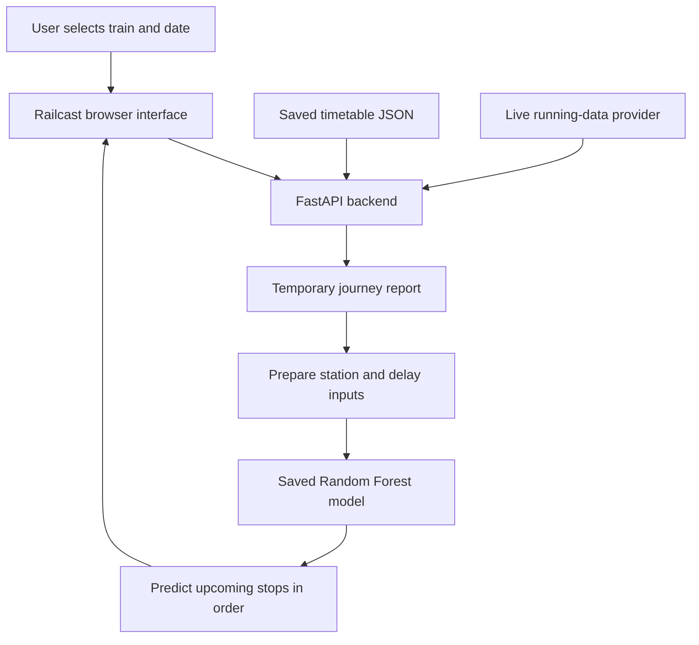

# Railcast — Train Arrival Delay Prediction

**A little foresight. A better journey.**

Railcast helps you answer a practical question: **“When might my train reach my station?”** Select a supported train, choose your journey date and arrival station, and get an estimated delay and arrival time based on live running information and a machine learning model.

For example, if a train is scheduled to arrive at **3:00 PM** and the model estimates a **20-minute delay**, its expected arrival would be **3:20 PM**. This is an illustration, not a measured prediction.

The project includes a browser application, a Python backend, a saved prediction model, and a separate manual prediction form for experimentation. It is a prototype: forecasts are estimates, and real-world forecasting accuracy has not yet been established.

## Contents

- [What you can do](#what-you-can-do)
- [Supported trains](#supported-trains)
- [How it works](#how-it-works)
- [Run locally](#run-locally)
- [Use the application](#use-the-application)
- [Technology and architecture](#technology-and-architecture)
- [Project structure](#project-structure)
- [API reference](#api-reference)
- [Model and data](#model-and-data)
- [Tests](#tests)
- [Troubleshooting](#troubleshooting)
- [Limitations and deployment](#limitations-and-deployment)
- [Contributing](#contributing)
- [Credits and license](#credits-and-license)

## What you can do

- **Find your journey:** select a train and date to retrieve live running information.
- **Explore the route:** view station names, schedules, and available live status.
- **Estimate an arrival:** choose an eligible upcoming station to see the predicted delay in minutes and expected arrival time.
- **Look several stops ahead:** the backend predicts each upcoming stop in order until it reaches your selected station.
- **Read times easily:** the interface uses AM/PM and day offsets where applicable.
- **Choose a theme:** switch between light and dark appearance.
- **Experiment manually:** use the separate Streamlit form to enter journey features yourself.

No JavaScript build step or separate frontend server is required.

## Supported trains

The current interface and API support these four train numbers. Names below follow the bundled timetable.

| Train number | Train name |
| --- | --- |
| `12625` | Kerala Express |
| `16306` | Kannur Ernakulam Express |
| `16325` | Nilambur Road Kottayam Express |
| `16346` | Netravati Express |

Prediction availability also depends on the station, current observations, and supported model inputs. Historical station entries may appear for reference but are excluded from current-route forecasts. Adding a train requires compatible training data, model encodings, timetable data, and application changes.

## How it works

Think of Railcast as combining **the timetable**, **what has happened so far**, and **patterns learned from past journeys**.

1. You select a train and journey date.
2. The backend reads the saved timetable and requests live running information from the configured provider.
3. It matches live observations to stations and prepares the information the model needs.
4. The model estimates the delay at the next upcoming station.
5. For a later destination, that estimate becomes part of the history used to predict the following stop.
6. The app adds the estimated delay to the scheduled arrival time and displays the result.

For a journey from **A → B → C → D**, selecting D means predicting B, then C, then D. This is called *recursive prediction*. Forecasts stay separate from actual observations, and each prediction request builds a fresh chain.

**Refresh the train when you want new observations.** Automatic refresh is disabled.

## Run locally

### 1. Prerequisites

- **Python 3.12**, recommended for compatibility with the saved model.
- A terminal and a modern web browser.
- A valid **API key for the configured live-data provider** at `api.irctc.dev`, plus internet access for live journeys.
- The supplied model and supporting files listed below.
- **Node.js**, only if you want to run the frontend tests.

Download or clone the repository, then open a terminal in this project's directory: the folder containing `requirements.txt`, `app.py`, `src/`, and `frontend/`. If you downloaded the larger repository, navigate into `Machine Learning/Trian Time Delay Prediction` first.

All commands below run from that project directory, not from `frontend/`.

### 2. Create an isolated Python environment

An environment keeps this project's installed packages separate from other projects.

**Windows PowerShell**

```powershell
py -3.12 -m venv .venv
.\.venv\Scripts\Activate.ps1
python -m pip install -r requirements.txt
```

**macOS / Linux**

```bash
python3.12 -m venv .venv
source .venv/bin/activate
python -m pip install -r requirements.txt
```

If PowerShell blocks activation, use the environment's Python directly:

```powershell
.\.venv\Scripts\python.exe -m pip install -r requirements.txt
.\.venv\Scripts\python.exe -m uvicorn src.main:app --reload --port 8000
```

Use `requirements.txt` for the application dependencies. The current `pyproject.toml` does not list the complete runtime stack. Keep **scikit-learn at `1.6.1`**, as pinned in the requirements, to match the saved model.

### 3. Configure live-data access

Create a file named `.env` in the project directory, or add this setting to an existing file:

```dotenv
API_KEY=replace_with_your_provider_api_key
```

The backend checks credentials in this order:

1. `src/.env`
2. The project-root `.env`
3. The server's `API_KEY` environment variable

An older key in `src/.env` therefore takes precedence over a new environment variable. Keep real keys private and out of Git commits; never put them in frontend JavaScript.

### 4. Check the required artifacts

These files must be available before starting the application:

| File | Purpose |
| --- | --- |
| `src/ml/model.pkl` | Saved Random Forest prediction model |
| `src/ml/preprocessing.json` | Training-compatible categories and station metadata |
| `src/data/train_timetables.json` | Saved station schedules and route information |

The model is approximately **130 MB**. If your checkout is missing it, obtain the matching artifact from the project maintainer and place it at the path above. Load only trusted model files.

### 5. Start the application

With the environment active:

```bash
python -m uvicorn src.main:app --reload --port 8000
```

Open:

- **Application:** [http://127.0.0.1:8000/](http://127.0.0.1:8000/)
- **Interactive API documentation:** [http://127.0.0.1:8000/docs](http://127.0.0.1:8000/docs)
- **Health endpoint:** [http://127.0.0.1:8000/health](http://127.0.0.1:8000/health)

FastAPI serves the browser interface and API together. Open the application through this address instead of double-clicking `frontend/index.html`.

The interface, health endpoint, and saved timetable can be accessed without a live-provider key once the required artifacts are present. Fetching live journeys requires a valid key.

## Use the application

1. Select one of the supported trains.
2. Choose the journey date.
3. Click **Find my train** to load the route and live information.
4. Choose an available upcoming **Arrival station**.
5. Click **Predict arrival**.
6. Read the **estimated delay** and **expected arrival** in the results panel.
7. Fetch the train again when you need updated running information.

If a prediction is unavailable, the app displays an explanation. A station that has already been passed, missing observations, or unsupported intermediate stops can prevent a forecast.

### Optional: manual Streamlit form

```bash
python -m streamlit run app.py
```

Open the local address printed by Streamlit. This separate interface is branded **RailSense** and accepts manually entered journey information. It uses the saved model but does not run the browser app's live, stop-by-stop prediction workflow.

## Technology and architecture

| Layer | Technology | Role |
| --- | --- | --- |
| Browser interface | HTML, CSS, vanilla JavaScript | Train selection, route display, themes, results |
| Backend | Python, FastAPI, Uvicorn | Serves the interface and handles API requests |
| Prediction | scikit-learn Random Forest, joblib | Loads the saved model and estimates arrival delay |
| Data preparation | pandas, NumPy | Shapes observations into model inputs |
| Live integration | Requests, python-dotenv | Fetches provider data using a server-side key |
| Timetable | Local JSON | Supplies saved schedules and station information |
| Manual demo | Streamlit | Supports experiments with user-entered features |
| Tests | Python unittest, Node.js | Checks prediction behavior and frontend logic |



Journey reports are kept in server memory. No database service is required for the current application.

## Project structure

```text
.
├── README.md                  # Project overview and setup
├── requirements.txt           # Application dependencies
├── pyproject.toml             # Project metadata; not the full runtime manifest
├── app.py                     # Separate manual Streamlit interface
├── frontend/
│   ├── index.html             # Railcast browser interface
│   ├── styles.css             # Layout and themes
│   ├── app.js                 # Browser behavior and API requests
│   └── train-background.svg   # Interface artwork
├── src/
│   ├── main.py                # FastAPI entry point and frontend serving
│   ├── routes/                # Live-data, timetable, and prediction routing
│   ├── services/              # Feature preparation and prediction logic
│   ├── depends/               # Shared model access and in-memory reports
│   ├── schemas/               # Prediction schema definitions
│   ├── data/                  # Saved train timetables
│   └── ml/                    # Saved model and preprocessing metadata
├── notebooks/                 # Training notebook and local datasets
├── scripts/                   # Optional timetable-refresh utility
├── tests/                     # Python and JavaScript regression checks
└── docs/                      # Audits and validation evidence
```

## API reference

An API lets another program request the same information used by the browser interface. The local base address is `http://127.0.0.1:8000`.

| Method | Endpoint | Purpose | Query parameters |
| --- | --- | --- | --- |
| `GET` | `/health` | Returns `{"status":"ok"}` | None |
| `GET` | `/timetable` | Returns the saved timetable without a provider request | `train_no` (defaults to `16346`) |
| `GET` | `/live` | Fetches live data and creates a journey report | `train_no` (defaults to `16346`), optional `date` |
| `POST` | `/predict` | Predicts an upcoming station using a report | Required `station_code`, `report_id` |

Use `YYYY-MM-DD` for the journey date. `/predict` takes **query parameters**, not a JSON request body. The report identifies the train and journey.

### Example workflow in PowerShell

```powershell
$journeyDate = Get-Date -Format 'yyyy-MM-dd'
$report = Invoke-RestMethod "http://127.0.0.1:8000/live?train_no=16346&date=$journeyDate"

# Inspect the route and select a station with prediction_available = True.
$report.data | Select-Object station_code, station_name, prediction_available
$stationCode = Read-Host 'Enter an eligible upcoming station code'

Invoke-RestMethod -Method Post -Uri "http://127.0.0.1:8000/predict?station_code=$stationCode&report_id=$($report.report_id)"
```

### Prediction response fields

| Field | Meaning |
| --- | --- |
| `report_id` | Identifier for the live journey snapshot |
| `train_no`, `station_code` | Requested train and arrival station |
| `predicted_delay_arrival_min` | Estimated arrival delay in minutes |
| `predict_time` | Calculated arrival clock time (`HH:MM:SS`), or `null` when unavailable |
| `prediction_method` | `recursive` for the current workflow |
| `prediction_steps` | Ordered station codes and predicted delays through the target |
| `prediction_note` | Explanation of the forecasting assumptions |

`predict_time` is a clock time, not a complete timestamp. Date-sensitive integrations should also account for the journey date, schedule, and delay.

Reports expire after **30 minutes**, and only the **latest 100 reports** are retained. Restarting the server clears them. Fetch `/live` again if `/predict` returns `409`.

## Model and data

The backend loads the saved **RandomForestRegressor** from `src/ml/model.pkl`. A Random Forest combines the estimates of many decision trees to produce a prediction. Its output here is **arrival delay in minutes**.

Inputs include the train and station, schedule information, distance, calendar features, and recent delay history. Training-compatible encodings are stored in `src/ml/preprocessing.json`; feature columns are aligned with the saved model.

### Important forecasting assumptions

- At least one observed station delay is required, including a valid delay at the latest passed/current station. A real zero-minute delay is valid.
- Earlier missing observations are skipped. When fewer than three observations exist, missing older history slots use the training convention of zero padding; averages use available history.
- Upcoming stops use earlier predictions in their history, rather than treating unknown future delays as zero.
- Previous departure delay is assumed equal to the previous arrival delay.
- Every intermediate stop must have supported inputs; otherwise the request returns `422` instead of a forecast.
- Predictions do not overwrite live observations or stored report features, and model outputs are not capped.

### Accuracy and reproducibility

There is **no verified production accuracy claim** for the current recursive forecasting workflow. Existing tests check behavior, not how closely predictions match real arrivals.

The [training audit](docs/training_audit_2026-11-02.md) documents notebook/artifact inconsistencies, random-split evaluation concerns, and extreme historical delays. Its findings describe the audited snapshot; some dataset paths have since changed. Stored notebook metrics should not be presented as validated live forecasting performance.

A suitable next evaluation would hold out entire later journeys, hide their future observations, and compare errors at 1, 2, 4, and 8 stops ahead against simply carrying forward the latest observed delay.

### Refreshing saved timetables

Normal startup uses the bundled JSON and does not scrape schedules. Maintainers can refresh it explicitly:

```bash
python scripts/scrape_timetables.py
```

The utility reads public Confirmtkt schedule pages and local historical CSV data. Inspect its input paths before running it, and review the resulting JSON changes. It updates timetable data; it does not retrain the model. See [prediction input notes](src/ml/README.md) for further details.

## Tests

From the project directory, with the Python environment active:

```bash
python -m unittest discover -s tests -v
node tests/frontend.test.cjs
```

Python API tests use FastAPI's `TestClient`. Its HTTP client dependency is not explicitly included in `requirements.txt`: if import fails, install the client requested by your installed Starlette version (`httpx2` in the existing local environment; `httpx` in older versions).

Tests cover delay propagation, valid zero observations, missing or invalid inputs, report handling, unsupported stations, and frontend behavior. Passing them does not establish forecasting accuracy.

## Troubleshooting

| Problem | What to check |
| --- | --- |
| `ModuleNotFoundError` | Activate the intended Python environment and install `requirements.txt`. Run commands from the project directory. |
| Model fails to load | Confirm `src/ml/model.pkl` exists and use Python 3.12 with scikit-learn 1.6.1. |
| Missing API key (`503`) | Set `API_KEY` in `.env`, `src/.env`, or the server environment. |
| Provider rejects the key (`401` / `403`) | Check the key and provider access. Remember that local `.env` files take precedence over environment variables. |
| Provider quota reached (`429`) | Wait or review the provider quota before fetching again. |
| Provider unavailable (`502` / `504`) | Check connectivity and retry; the upstream response may be invalid or delayed. |
| Journey report unavailable (`409`) | Fetch the train again to create a fresh report. |
| Prediction unavailable (`422`) | Read the response detail; check the latest observed delay and whether every intermediate station has supported inputs. |
| Station not found (`404` from `/predict`) | Choose a station from the same journey report. |
| Page looks unstyled or API calls fail | Open the FastAPI address, not the HTML file directly. |
| Port 8000 is occupied | Start Uvicorn with `--port 8001` and open that port instead. |

## Limitations and deployment

- **Coverage is limited:** only the four configured trains and supported station inputs are available.
- **Forecast uncertainty grows with distance:** earlier prediction errors can affect later stops.
- **Training and live routes differ:** historical retained reports may skip stations, while runtime prediction traverses the current route in order.
- **Data can become stale:** schedules are saved locally, and live status updates only when requested.
- **The provider is an external dependency:** access, quotas, availability, and data quality affect the experience.
- **Reports are process-local:** use one application worker. Multiple workers do not share report IDs; a shared report store is needed before scaling across workers or instances.
- **The current server is a prototype:** CORS is broadly configured, and application authentication and rate limiting are not implemented. Review these before exposing it publicly.

The setup command uses `--reload` for development. A deployment should omit it, provide the required artifacts and server-side key, and keep a single worker until report storage is shared.

## Contributing

1. Describe the proposed change or bug, including the train, station, and reproduction steps when relevant.
2. Work in a separate branch and keep the change focused.
3. Update documentation when changing setup, endpoints, supported trains, or prediction behavior.
4. Run the relevant existing tests and add regression coverage for behavior changes.
5. Submit a pull request explaining the change and how it was verified.

Do not include API keys or private credentials in issues, screenshots, or commits. Changes to the model, training data, or preprocessing should include reproducibility notes and an appropriate forecasting evaluation.

## Credits and license

- Project author recorded in `pyproject.toml`: **Safvan sidheeq**.
- Live running information comes from the configured `api.irctc.dev` integration.
- Saved schedule provenance is recorded in the timetable JSON; the refresh utility uses public Confirmtkt pages.
- Built with the open-source Python and browser technologies listed above.

No license file was found in the inspected project or repository root. Reuse permissions are therefore not specified; contact the maintainer before redistributing or adapting the project. Third-party data and services remain subject to their own terms.
